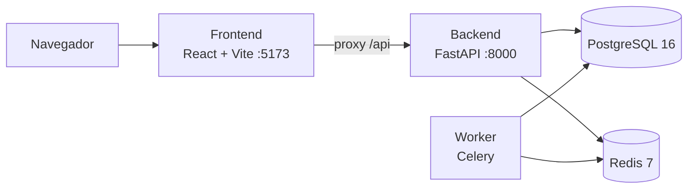
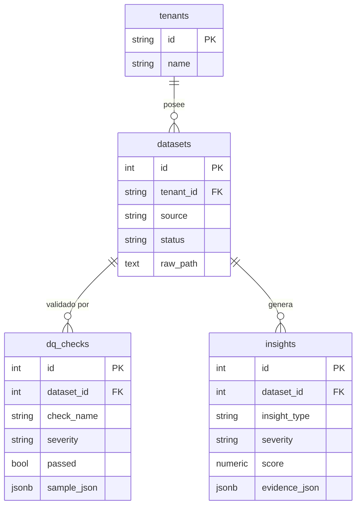

# AI Ops Copilot — Retail Analytics Automation (SaaS)

🌐 [English](README.md) · **Español**

[](https://github.com/Mrcipo/AI-Ops-Copilot---Retail-Analytics-Automation-SaaS/actions/workflows/ci.yml)


> **Estado del proyecto: etapa inicial.** Las bases (servicios, esquema de base de datos, migraciones y una UI de estado) están listas y funcionando. Las funciones de analítica e IA descritas en la [Hoja de ruta](#hoja-de-ruta) están planificadas y **todavía no están implementadas**.

## Visión

Un SaaS multi-tenant que convierte datos crudos de retail en insights accionables para operaciones. El flujo objetivo es:

1. Ingestar un dataset de retail por tenant (el esquema está modelado sobre el dataset público de e-commerce Olist).
2. Ejecutar controles de calidad de datos sobre cada dataset.
3. Calcular métricas de negocio diarias (ingresos, pedidos, unidades, ticket promedio) por categoría.
4. Generar insights priorizados y con evidencia para los equipos de operaciones.

## Qué funciona hoy

| Área | Estado |
|---|---|
| Servicio FastAPI con `GET /api/v1/health` y `GET /api/v1/db/ping` | Funcionando |
| PostgreSQL 16 con una migración de Alembic que crea el esquema multi-tenant completo | Funcionando |
| Worker de Celery conectado a Redis (todavía sin tareas definidas) | Estructura base |
| UI en React + TypeScript + Vite que muestra el estado del backend mediante un proxy de desarrollo | Funcionando |
| Stack con Docker Compose, healthchecks y dependencias entre servicios | Funcionando |
| CI: verificación de imports y migraciones del backend, build del frontend y validación de Compose | Funcionando |

## Arquitectura



## Modelo de datos

Todas las tablas están acotadas por `tenant_id`, de modo que varios clientes pueden compartir una misma base.



También forman parte del esquema, con clave por `tenant_id` y cargadas desde el dataset Olist: `olist_orders`, `olist_order_items`, `olist_products`, además de la tabla agregada `metrics_daily`.

## Puesta en marcha

Requisitos: Docker y Docker Compose.

```bash
# 1. Variables de entorno (cambiá la contraseña en .env)
cp .env.example .env

# 2. Levantar el stack
docker compose up --build

# 3. Crear el esquema de base de datos
docker compose exec backend alembic upgrade head
```

Smoke tests:

```bash
curl http://localhost:8000/api/v1/health     # {"status":"ok"}
curl http://localhost:8000/api/v1/db/ping    # {"status":"ok"}
```

UI: <http://localhost:5173>

Puertos expuestos: frontend `5173`, backend `8000`, PostgreSQL `5435` (lado host), Redis `6379`.

## Configuración

| Variable | Propósito |
|---|---|
| `APP_ENV`, `LOG_LEVEL` | Entorno de ejecución y nivel de logs |
| `DEFAULT_TENANT_ID` | Tenant por defecto (`demo`) |
| `POSTGRES_DB`, `POSTGRES_USER`, `POSTGRES_PASSWORD` | Inicialización de la base |
| `DATABASE_URL` | URL de SQLAlchemy. Dentro de Compose usar `postgres:5432` (`5435` es solo el puerto mapeado en el host) |
| `REDIS_URL` | Broker y backend de resultados de Celery |

## Estructura del proyecto

```
backend/
├── app/            App FastAPI, config, modelos, sesión de DB, worker de Celery
└── alembic/        Migraciones de base de datos
frontend/
└── src/            UI en React + TypeScript
docker-compose.yml  postgres, redis, backend, worker, frontend
```

## Hoja de ruta

- [ ] Ingesta del dataset Olist como tarea de Celery
- [ ] Controles de calidad de datos persistidos en `dq_checks`
- [ ] Agregación de métricas diarias en `metrics_daily`
- [ ] Generación de insights (anomalías, principales variaciones) persistidos en `insights`
- [ ] Explicaciones de los insights asistidas por IA
- [ ] Endpoints REST para datasets, métricas e insights
- [ ] Vistas de dashboard en el frontend
- [ ] Tests automatizados para la API y el pipeline
- [ ] Autenticación y control de acceso por tenant

## Licencia

[MIT](LICENSE)
