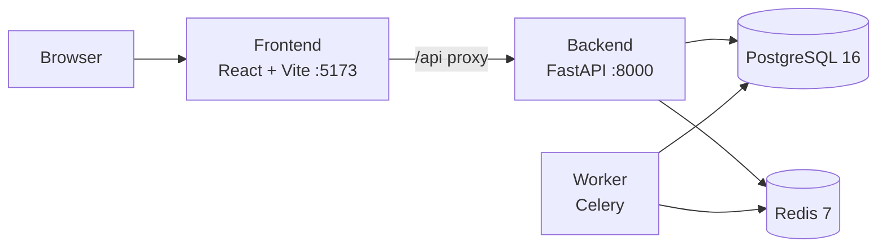
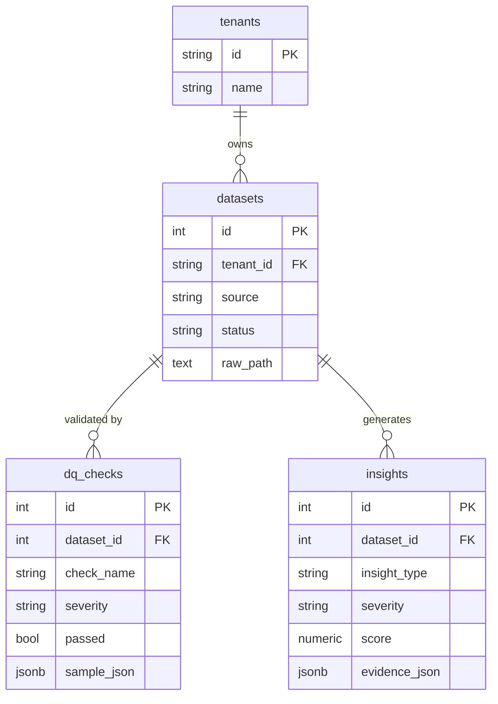

# AI Ops Copilot — Retail Analytics Automation (SaaS)

🌐 **English** · [Español](README.es.md)

[](https://github.com/Mrcipo/AI-Ops-Copilot---Retail-Analytics-Automation-SaaS/actions/workflows/ci.yml)


> **Project status: early stage.** The foundations (services, database schema, migrations and a status UI) are in place and working. The analytics and AI features described under [Roadmap](#roadmap) are planned and **not implemented yet**.

## Vision

A multi-tenant SaaS that turns raw retail data into actionable operations insights. The target workflow is:

1. Ingest a retail dataset per tenant (the schema is modeled on the public Olist e-commerce dataset).
2. Run data-quality checks on every dataset.
3. Compute daily business metrics (revenue, orders, units, average order value) by category.
4. Surface ranked, evidence-backed insights for operations teams.

## What works today

| Area | Status |
|---|---|
| FastAPI service with `GET /api/v1/health` and `GET /api/v1/db/ping` | Working |
| PostgreSQL 16 with an Alembic migration creating the full multi-tenant schema | Working |
| Celery worker connected to Redis (no tasks defined yet) | Scaffolded |
| React + TypeScript + Vite UI that shows the backend status through a dev proxy | Working |
| Docker Compose stack with healthchecks and service dependencies | Working |
| CI: backend import and migration check, frontend build, Compose validation | Working |

## Architecture



## Data model

Every table is scoped by `tenant_id`, so several customers can share one database.



Also in the schema, keyed by `tenant_id` and loaded from the Olist dataset: `olist_orders`, `olist_order_items`, `olist_products`, plus the aggregated `metrics_daily` table.

## Getting started

Requirements: Docker and Docker Compose.

```bash
# 1. Environment variables (edit the password in .env)
cp .env.example .env

# 2. Start the stack
docker compose up --build

# 3. Create the database schema
docker compose exec backend alembic upgrade head
```

Smoke tests:

```bash
curl http://localhost:8000/api/v1/health     # {"status":"ok"}
curl http://localhost:8000/api/v1/db/ping    # {"status":"ok"}
```

UI: <http://localhost:5173>

Exposed ports: frontend `5173`, backend `8000`, PostgreSQL `5435` (host side), Redis `6379`.

## Configuration

| Variable | Purpose |
|---|---|
| `APP_ENV`, `LOG_LEVEL` | Runtime environment and log level |
| `DEFAULT_TENANT_ID` | Tenant used by default (`demo`) |
| `POSTGRES_DB`, `POSTGRES_USER`, `POSTGRES_PASSWORD` | Database bootstrap |
| `DATABASE_URL` | SQLAlchemy URL. Inside Compose use `postgres:5432` (`5435` is only the host-mapped port) |
| `REDIS_URL` | Celery broker and result backend |

## Project structure

```
backend/
├── app/            FastAPI app, config, models, DB session, Celery worker
└── alembic/        Database migrations
frontend/
└── src/            React + TypeScript UI
docker-compose.yml  postgres, redis, backend, worker, frontend
```

## Roadmap

- [ ] Olist dataset ingestion as a Celery task
- [ ] Data-quality checks persisted in `dq_checks`
- [ ] Daily metrics aggregation into `metrics_daily`
- [ ] Insight generation (anomalies, top movers) persisted in `insights`
- [ ] AI-assisted insight explanations
- [ ] REST endpoints for datasets, metrics and insights
- [ ] Dashboard views in the frontend
- [ ] Automated tests for the API and the pipeline
- [ ] Authentication and per-tenant access control

## License

[MIT](LICENSE)
